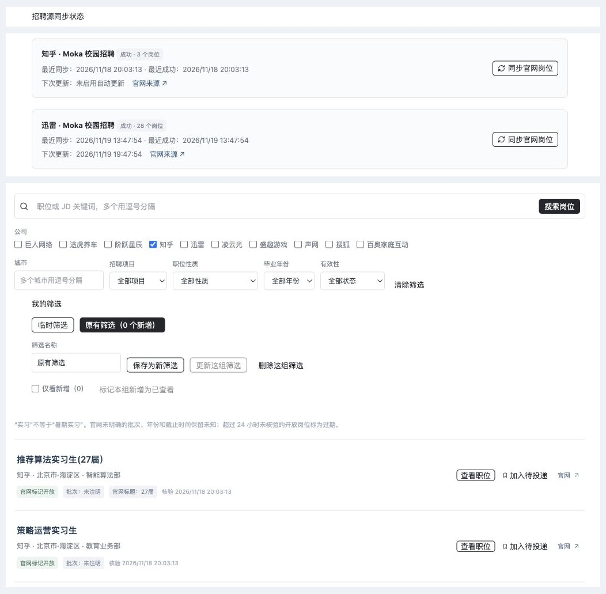

# 求职工作台

在本地浏览器里看秋招和实习岗位，跟进自己的投递进度。选好想关注的公司，工作台会定期同步招聘官网；下次打开时，直接查看符合你条件的新岗位。

[快速开始](#快速开始) · [支持的招聘来源](#支持的招聘来源) · [开发与贡献](#开发与贡献)



## 快速开始

需要 **Node.js 24 或更新版本**，以及可以访问招聘官网的网络。

```bash
git clone https://github.com/qyf700/job-tracker.git
cd job-tracker
npm ci
npm run build
npm run db:migrate:local
npm run dev
```

打开 [http://127.0.0.1:5173](http://127.0.0.1:5173)，点击登录即可进入本地工作台，无需 ChatGPT 账号。

1. **关注公司。** 在「发现岗位 → 自动更新来源」里勾选知乎、迅雷或其他公司，再点击「保存来源并首次同步」。
2. **保存筛选。** 例如选北京和上海，搜索「后端, AI 应用」，将条件保存为「后端实习」。每组筛选单独统计新增，可以只看本组新增，也可以标记为已查看。
3. **跟进申请。** 将感兴趣的职位加入待投递，打开原文到公司官网申请，再回工作台更新投递状态、记录面试和待办。台账也支持更正实际投递时间，以及按到期情况筛选待跟进事项。收藏自目录的岗位会在台账里显示官网当前状态。官网自动投递目前暂停。

## 支持的招聘来源

目前接入 10 个由 Moka 承载的企业官网招聘页面。每条职位都保留官网原文和最近核验时间，详情保留首次收录、最近重新开放和本次关闭的时间。批次与截止日期以官网信息为准。

| 招聘官网 | 招聘官网 |
| --- | --- |
| [知乎](https://app.mokahr.com/campus_apply/zhihu/3818) | [迅雷](https://app.mokahr.com/campus_apply/xunlei/26600) |
| [阶跃星辰](https://app.mokahr.com/campus-recruitment/step/94905) | [巨人网络](https://app.mokahr.com/campus-recruitment/ztgame/92438) |
| [声网](https://app.mokahr.com/campus_apply/agora/4789) | [盛趣游戏](https://app.mokahr.com/campus-recruitment/shengqu/96336) |
| [搜狐](https://app.mokahr.com/campus-recruitment/sohu/5682) | [百奥家庭互动](https://app.mokahr.com/campus_apply/aobi/25016) |
| [途虎养车](https://app.mokahr.com/campus-recruitment/tuhu/28398) | [凌云光](https://app.mokahr.com/campus_apply/lusterinc/44882) |

已关注的来源默认每 6 小时更新一次，可在网页上修改频率。关掉网页后，本地服务仍会继续更新。来源同步失败时会保留上次成功的结果，并提供手动重试。

## 本地数据与升级

岗位、筛选、投递记录和简历文件保存在本地的 `.wrangler/state/`。备份时，先退出本地服务，再复制这个目录。

更新代码后，重新运行 `npm ci`、`npm run build` 和 `npm run db:migrate:local`，再启动服务。旧版单组筛选会迁为「原有筛选」，保留查看进度、已选来源及更新频率。

## 开发与贡献

工作台使用 React、TypeScript 和 Vinext，数据通过 Drizzle 写入 Cloudflare D1，简历文件存储在 R2。本地运行时使用本机的 D1 和 R2 模拟环境，岗位依然从招聘官网实时获取。

- **接入招聘来源**可从 [目录适配器](lib/catalog/) 开始。提交前请核验官网列表、分页、职位详情与开放状态。
- **运行测试**使用 `npm test`。构建后，执行 `CATALOG_LOCAL_LIVE=1 npm run test:m1:integration` 可在临时数据库中同步知乎与迅雷，验证目录和筛选。
- **查看实现**可读 [岗位目录与 API](docs/m2-catalog.md)，或直接浏览 [接口代码](app/api/) 和 [数据库结构](db/schema.ts)。
- **反馈问题**请开 [GitHub Issue](https://github.com/qyf700/job-tracker/issues)。同步问题请附公司名、官网链接和错误提示。

## 许可证

[MIT](LICENSE)
